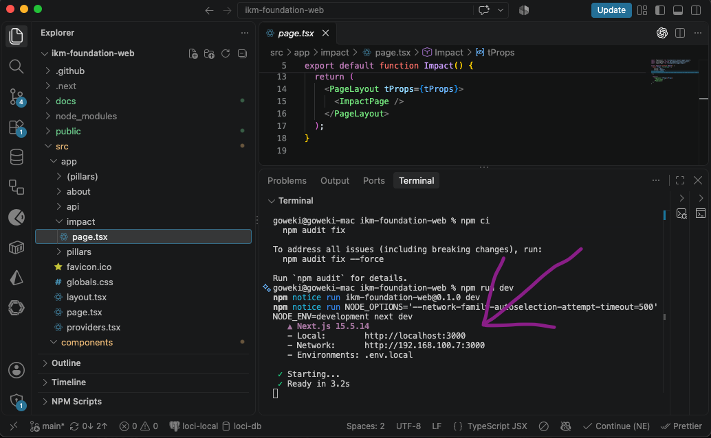
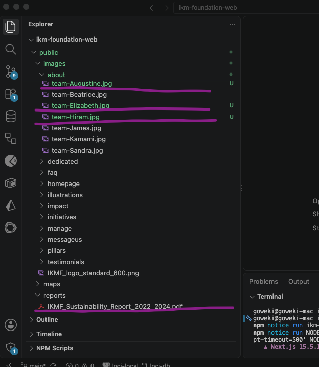
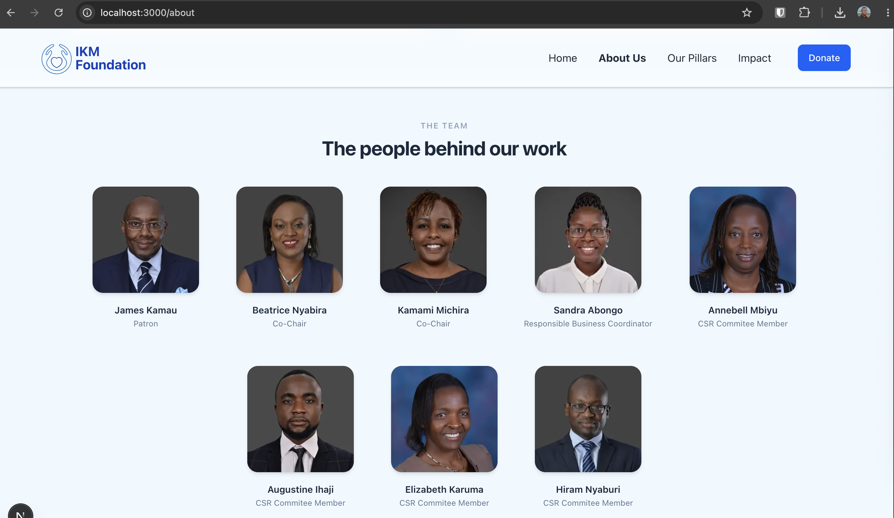
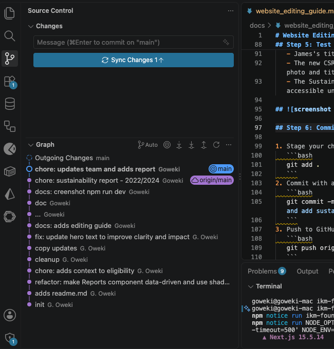
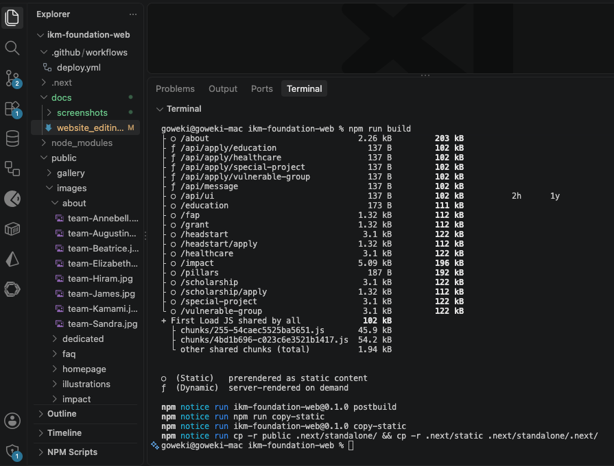
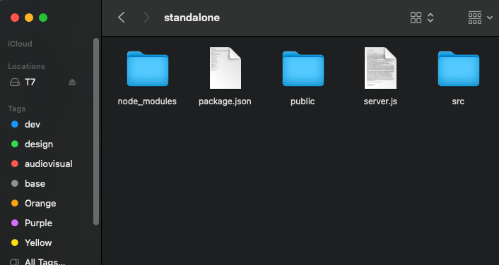
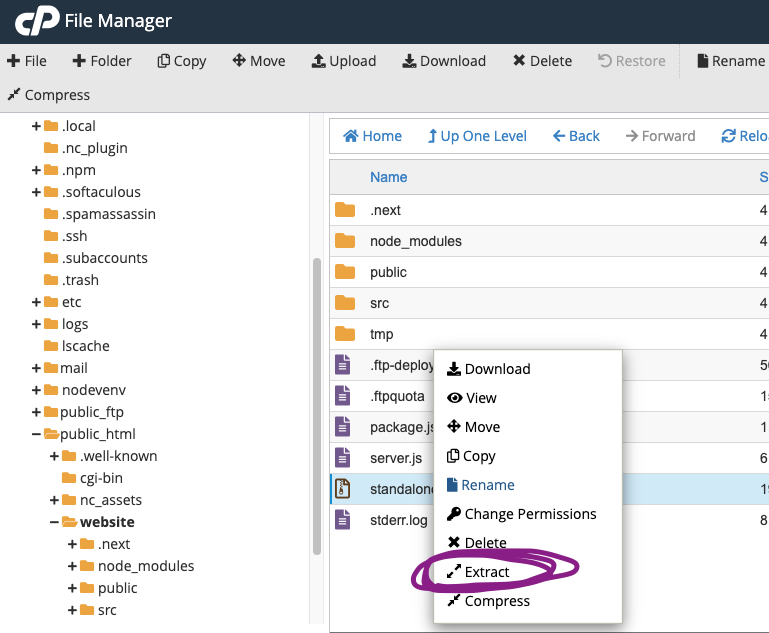

 # NextJS Website Editing Guide

This guide covers updating team details and adding impact reports to the website.

## Prerequisites

- [VS Code](https://code.visualstudio.com/) installed
- Understanding of React and/or NextJS
- Basic GitHub and Git knowledge
- [Repository link](https://github.com/goweki/ikm-foundation-web)

---

## Step 1: Clone the Repository & Open in VS Code

1. Open your terminal and clone the repository:

   ```bash
   git clone <repository-link>
   ```

2. Open the project folder in VS Code.
3. Install dependencies and run the development server:

   ```bash
   npm ci
   npm run dev
   ```

4. Open `http://localhost:3000` in your browser to view the site.



---

## Step 2: Handle Assets (Photos & Reports)

1. Drop the new **CSR Committee Photo** into the public assets folder (e.g., `public/images/about/`).
2. Drop the new **Sustainability Report PDF** into the documents folder (e.g., `public/reports/`).



---

## Step 3: Update the Team Section

1. Locate the component with the data (team component: `src/components/pages/About.tsx`).
2. Open the file and find James's entry to update his title.

```json
// Example Data Structure
{
  "name": "James Smith",
  "title": "Patron", // Updated from Managing Partner
  "image": "/images/team-James.jpg"
}
```


### Add CSR Committee Member

- Add a new object to the team array with the new member's details and the uploaded photo path, setting their appropriate title.

```json
{
  "name": "Jane Doe",
  "title": "CSR Committee Member",
  "image": "/images/team/csr-new-member.jpg"
}
```

---

## Step 4: Update the Impact Section (Annual Reports)

1. Locate the Impact component: `src/components/pages/Impact/index.tsx`.
2. Add a new entry for the Sustainability Report, linking to the PDF file you placed in the `public` folder.

```json
// Example Reports Array
{
  "title": "2022/2024 Sustainability Report",
  "description": "Driving Impact Through Purpose",
  "href": "/reports/IKMF_Sustainability_Report_2022_2024.pdf"
}
```


---

## Step 5: Test Locally

1. Check your local browser preview (`http://localhost:3000`) to confirm:
   - James's title reads "Patron".
   - The new CSR Committee member is visible with their photo and title.
   - The Sustainability Report is downloadable/accessible under the Annual Reports section.

## 

## Step 6: Commit and Push Changes to Update Codebase

1. Stage your changes in git:

   ```bash
   git add .
   ```

2. Commit with a clear message:

   ```bash
   git commit -m "Update team titles, add CSR member, and add sustainability report"
   ```

3. Push to GitHub to deploy:

   ```bash
   git push origin main
   ```



## Step 7: Build website

Build project for production:

```bash
npm run build
```



## Step 8: Prepare the deployment files

1. Open the generated `.next/standalone` folder.
2. Select its contents, including `server.js` and any asset folders.
3. Compress the selected contents into a ZIP file.

Ensure that `server.js` is at the root of the ZIP archive, not inside an additional sub-folder.



## Step 9: Upload and extract the build

1. Log in to your hosting provider's cPanel.
2. Open **File Manager**.
3. Navigate to the website's document root, in this case: `public_html/website`.
4. Back up the existing website files before replacing anything.
5. Upload the ZIP file to the website's document root.
6. Select the ZIP file and click **Extract**.
7. Confirm that `server.js` and the asset folders are directly inside root `public_html/website`.
8. Remove the ZIP file after verifying the extraction, if it is no longer needed.



## Step 10: Verify the deployment

_Note:_ Changes may take up to 6 hours to be available online due propagation

1. Open the website in a browser.
2. Check the updated content and images.
3. Test navigation and internal links.
4. Check the browser console for errors.
5. Test the website on both desktop and mobile.

If the previous version still appears after a day, clear the browser cache and check whether a CDN or hosting cache needs to be cleared.
